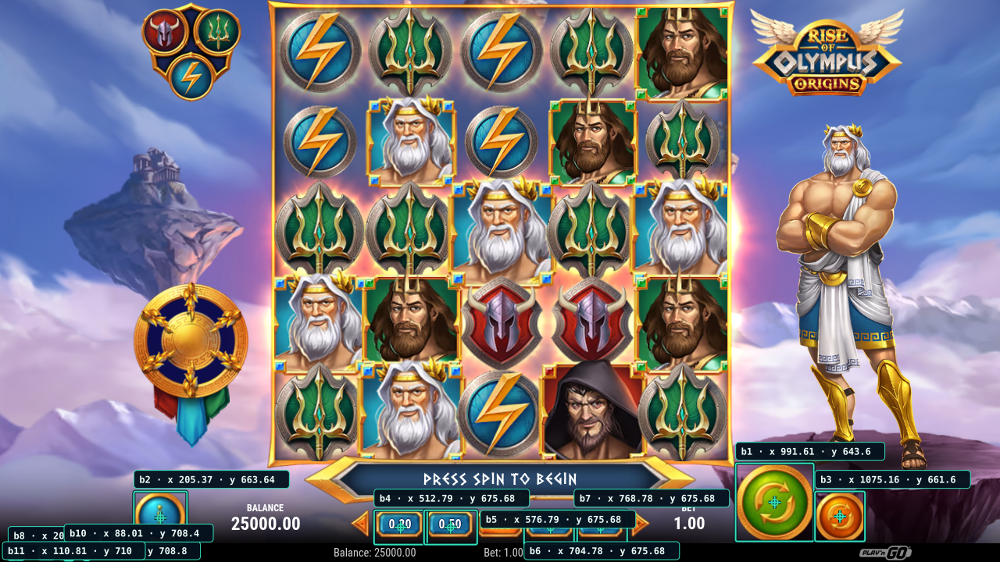
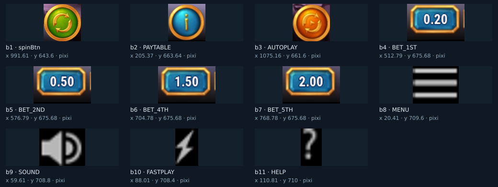
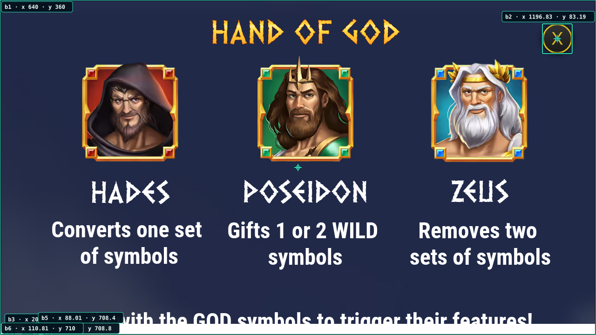
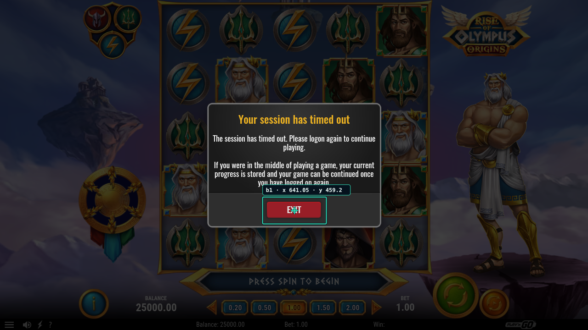
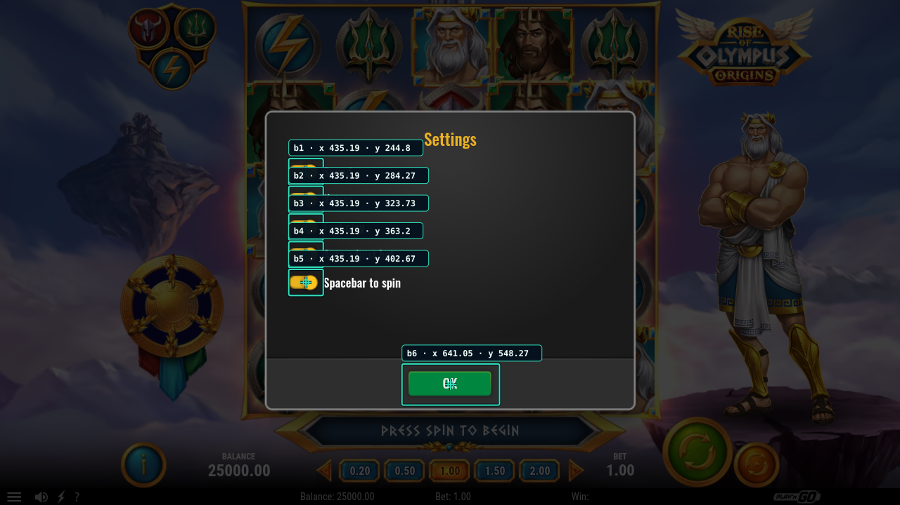

# Rise of Olympus Origins: detección por pantalla

Prueba de una demo real de Play’n GO en [GitHub Actions, ejecución 40231409619](https://github.com/Shisetsu-Code/firetrace/actions/runs/40231409619), el 25 de octubre de 2026. Sesión: `playngo-screens-20261025-01`.

Las coordenadas son **píxeles CSS del viewport de 1280 × 720**, con origen arriba a la izquierda. No representan coordenadas del escritorio. Cada `bN` pertenece a su observación; no conserva su significado al cambiar de pantalla.

Cada `verify` explícito tomó **tres muestras**, con esperas configuradas de **2000 ms** entre lecturas. Inspeccionar DOM/Pixi y capturar también consume tiempo: las verificaciones duraron entre **41,41 y 56,09 s**. No fueron capturas separadas exactamente dos segundos. Esta ejecución usó detección DOM/Pixi y no solicitó visión IA.

[Datos completos de las cinco pantallas y sus recuadros](game-screen-walkthrough.json).

| Pantalla | Candidatos por muestra | Posiciones publicadas | Estado | Duración |
|---|---:|---:|---|---:|
| Introducción | 3 | 0 | Inestable | 41,41 s |
| Tablero, con filtros explícitos | 11 | 11 | Estable | 42,98 s |
| Tabla de pagos | 6 | 6; incluye un contenedor falso | Estable | 47,14 s |
| Sesión caducada | 1 | 1 | Estable | 51,93 s |
| Ajustes | 6 | 6 | Estable | 56,09 s |

## 1. Introducción: posición retenida


Las tres lecturas encontraron **tres candidatos**, pero cambió la apariencia de `continueBtn`: diferencia máxima **0,02860**, superior al umbral **0,015**. La geometría permaneció igual. Resultado: **inestable, `buttons: []`, ninguna coordenada publicada**. Esto muestra el rechazo esperado ante un control que todavía cambia.

Para continuar se usó un clic explícito en **(640, 562)**, localizado en la captura actual; no fue un clic a un identificador verificado. Las pantallas de carga se atravesaron mediante esperas explícitas.

[JSON de introducción](../ci-results/playngo-screens-20261025-01/observations/c1e09ae8-91fb-4f49-8fa3-573c7bcbf9b1/buttons.json).

## 2. Tablero: once controles filtrados y estables





Se excluyeron explícitamente tres etiquetas en cada muestra:

```json
[
  "BET_DEC",
  "BET_INC",
  "XWins are achieved with 3 or more matching symbols in a row, horizontally or vertically. The same symbol can be used in different winning combinations. Winning "
]
```

Los **once controles restantes** permanecieron estables y sus recortes muestran iconos reconocibles. La diferencia máxima de apariencia fue **0,00743**; la variación geométrica, **0 px**. Es el resultado de ese subconjunto, no una enumeración completa sin filtros.

| ID | Control | Punto X | Punto Y |
|---|---|---:|---:|
| b1 | spinBtn | 991,61 | 643,60 |
| b2 | PAYTABLE | 205,37 | 663,64 |
| b3 | AUTOPLAY | 1075,16 | 661,60 |
| b4 | BET_1ST | 512,79 | 675,68 |
| b5 | BET_2ND | 576,79 | 675,68 |
| b6 | BET_4TH | 704,78 | 675,68 |
| b7 | BET_5TH | 768,78 | 675,68 |
| b8 | MENU | 20,41 | 709,60 |
| b9 | SOUND | 59,61 | 708,80 |
| b10 | FASTPLAY | 88,01 | 708,40 |
| b11 | HELP | 110,81 | 710,00 |

El clic verificado en **b2/PAYTABLE** abrió la tabla de pagos. No se pulsaron giro ni autoplay en este recorrido.

[JSON del tablero, incluidos los recuadros](../ci-results/playngo-screens-20261025-01/observations/94a1ea1a-00f2-4129-9e9d-222e146b8c1b/buttons.json).

## 3. Tabla de pagos: seis candidatos, con limitaciones



Las tres muestras fueron idénticas. Sin embargo, **estabilidad no equivale a clasificación correcta**: apareció un contenedor de pantalla completa. El filtro heredado no lo eliminó; registró cero exclusiones y el texto del contenedor había variado.

| ID | Candidato | Punto X | Punto Y | Evaluación |
|---|---|---:|---:|---|
| b1 | Contenedor DOM, 1280 × 720 | 640,00 | 360,00 | Falso positivo como botón aislado |
| b2 | X | 1196,83 | 83,19 | Cierre reconocido visualmente; recuadro de 64 × 64 |
| b3 | MENU | 20,41 | 709,60 | Barra inferior, sin confirmación visual en este estado |
| b4 | SOUND | 59,61 | 708,80 | Barra inferior, sin confirmación visual en este estado |
| b5 | FASTPLAY | 88,01 | 708,40 | Barra inferior, sin confirmación visual en este estado |
| b6 | HELP | 110,81 | 710,00 | Barra inferior, sin confirmación visual en este estado |

Las etiquetas superpuestas tapan la franja inferior; esta captura no permite confirmar esos cuatro controles. El intento de cerrar con **b2/X** fue rechazado con **`TARGET_CHANGED`**. No se determinó aquí su causa. Un clic explícito en **(1197, 83)** cerró la tabla y dejó visible un aviso de sesión caducada; no debe presentarse como un clic verificado exitoso.

[JSON de tabla de pagos](../ci-results/playngo-screens-20261025-01/observations/faccc576-9d03-44be-8bb0-4e7f899a1647/buttons.json).

## 4. Sesión caducada



El detector publicó **un solo botón: b1/EXIT**, en **(641,05; 459,20)**. Las tres muestras fueron estables y no incluyeron los controles bloqueados del tablero. Su recuadro fue **x=571,72; y=429,87; ancho=138,66; alto=58,67**. La verificación duró **51,93 s**. No se pulsó EXIT; se abrió de nuevo la URL pública de la demo para continuar el recorrido.

[JSON del aviso](../ci-results/playngo-screens-20261025-01/observations/dc60d529-2125-4afc-8a01-2ab5b963cbcc/buttons.json).

## 5. Ajustes



Se abrió MENU con un clic explícito en **(20, 710)**, inspeccionado en la captura actual de la nueva sesión. El detector encontró **seis controles estables** y dejó fuera los controles del tablero cubierto.

| ID | Etiqueta del detector | Texto visible | Punto X | Punto Y |
|---|---|---|---:|---:|
| b1 | SOUND | Sound | 435,19 | 244,80 |
| b2 | VOICEOVER | Voices | 435,19 | 284,27 |
| b3 | FASTPLAY | Fast play | 435,19 | 323,73 |
| b4 | AUTOADJUSTBET | Auto adjust bet | 435,19 | 363,20 |
| b5 | SPACEBARSPIN | Spacebar to spin | 435,19 | 402,67 |
| b6 | OK | OK | 641,05 | 548,27 |

Las etiquetas de coordenadas cubren parte de los textos del menú; la [captura limpia](../ci-results/playngo-screens-20261025-01/observations/3f8b13c2-ddac-4e86-993b-0ef720d3e563/screenshot.png) y los [recortes individuales](../ci-results/playngo-screens-20261025-01/observations/3f8b13c2-ddac-4e86-993b-0ef720d3e563/buttons.png) permiten comprobar la correspondencia.

[JSON de ajustes](../ci-results/playngo-screens-20261025-01/observations/3f8b13c2-ddac-4e86-993b-0ef720d3e563/buttons.json).

El [clic verificado en b6/OK](../ci-results/playngo-screens-20261025-01/responses/000021.json), con su `observationId`, se ejecutó correctamente en **(641,05; 548,27)**. La [captura posterior](../ci-results/playngo-screens-20261025-01/observations/39064448-af63-4b29-94e4-69dd50a87835/screenshot.png) registra el regreso al tablero. No se cambiaron los interruptores.

## Cierre y alcance

El comando explícito [STOP](../ci-results/playngo-screens-20261025-01/responses/000022.json) cerró la sesión y el trabajo de GitHub Actions terminó con `success`, con su evidencia subida. Este recorrido cubre introducción, tablero, tabla de pagos, aviso de sesión caducada y ajustes. Los identificadores y las coordenadas documentan esas observaciones históricas; para una sesión nueva hay que pedir una nueva verificación.

La prueba deja dos límites pendientes de mejorar: filtrar contenedores DOM que no son botones y acomodar las etiquetas para que no tapen controles contiguos. También muestra el coste real de las tres inspecciones, que se suma a las pausas configuradas.
