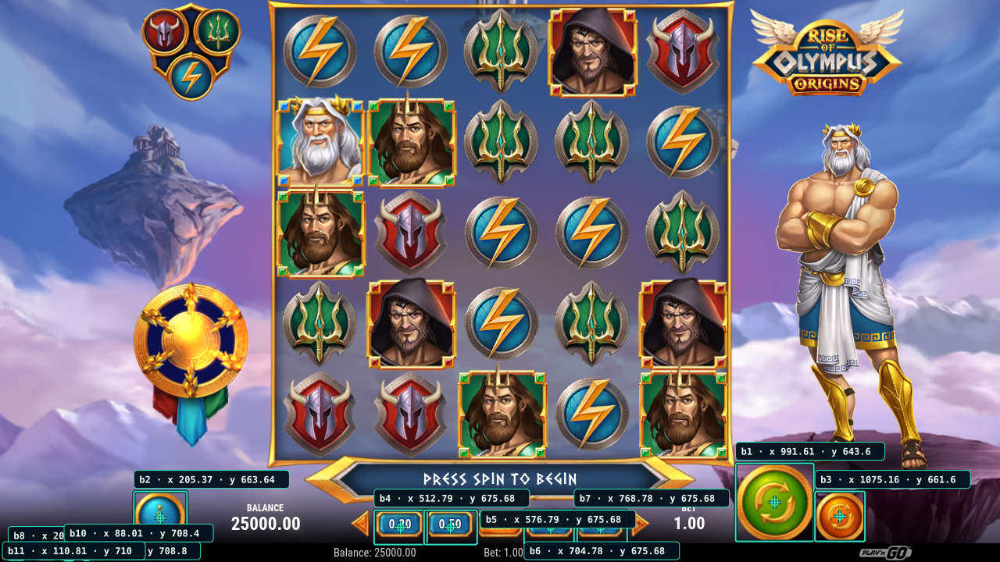
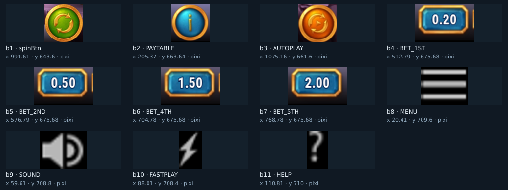
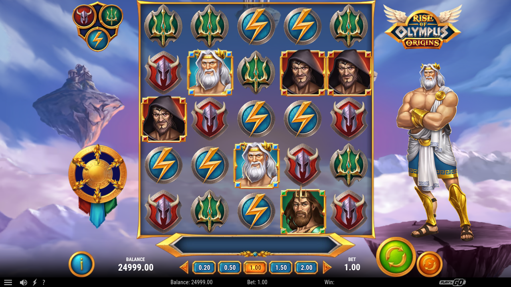

# Prueba real de Play’n GO en GitHub Actions

## Resultado

El **25 de octubre de 2026** se probó **Rise of Olympus Origins** de Play’n GO en Chromium dentro de un runner Ubuntu de GitHub Actions, usando la demo pública con `practice=1`.

Se superaron la carga y la introducción, se verificaron **11 controles reales del juego con tres lecturas estables** y se ejecutó **un único giro de demostración mediante un ID verificado**. El tablero cambió y el saldo de demo pasó de **25000.00 a 24999.00**, con apuesta de **1.00**. No se activó autoplay.

La sesión se cerró con `STOP`. El job y la subida del artefacto terminaron correctamente.

- [Ejecución final en GitHub Actions](https://github.com/Shisetsu-Code/firetrace/actions/runs/40226611494).
- [Commit probado](https://github.com/Shisetsu-Code/firetrace/commit/b67d4c3a579402d048eadcaddffd0e6be31802eb).
- Rama: `codex/button-browser-playngo-20261025`.
- Sesión: `playngo-rise-20261025-03`.
- [Historial de comandos](../ci-results/playngo-rise-20261025-03/history.json), [estado final](../ci-results/playngo-rise-20261025-03/state.json) e [índice de evidencia](../ci-results/playngo-rise-20261025-03/index.json).

- [Artefacto de Actions](https://github.com/Shisetsu-Code/firetrace/actions/runs/40226611494/artifacts/12611665681): `button-browser-playngo-40226611494-1`, 26653817 bytes; expira el 1 de noviembre de 2026. Las capturas y respuestas también están guardadas en la rama.

## Recorrido ejecutado

| Paso | Método | Resultado |
|---|---|---|
| Abrir la demo oficial | `goto` inicial | Juego cargado en el runner |
| Esperar e inspeccionar | `wait 20000` y `snapshot` | Introducción visible |
| Continuar | Clic explícito en `640, 562`, elegido de la captura de esta sesión | Tablero visible |
| Primera verificación del tablero | Exclusión de las dos flechas de apuesta | Rechazada: también cambió la apariencia del contenedor HTML completo |
| Verificación de la selección | Nueva orden, excluyendo además ese contenedor | **11 controles, 3 de 3 lecturas estables** |
| Giro de demo | `click b1` con el ID de la observación estable | **Ejecutado una vez** en `991.61, 643.60` |
| Comprobar resultado | `wait 8000` y `snapshot` | Nueva distribución de símbolos y saldo 24999.00 |
| Cerrar | `STOP` explícito | Navegador cerrado y job finalizado |

El clic de la introducción fue un comando de coordenadas elegido tras inspeccionar la captura. **No se presenta como un clic por ID verificado.** El giro sí utilizó la observación que había superado las tres lecturas.

## Capturas

### Tablero con recuadros y coordenadas



### Controles aislados



En el tablero algunas etiquetas de iconos muy próximos se superponen. La hoja de recortes y el JSON contienen las coordenadas completas para anotarlas.

### Resultado del único giro



La captura posterior al clic tiene estado `unverified`: no reutiliza posiciones antiguas ni inicia una verificación automáticamente.

## Verificación y tiempos medidos

- Observación: `11f96dbb-f0a0-48cb-9ca8-d064ae55d262`.
- [Respuesta de la verificación](../ci-results/playngo-rise-20261025-03/responses/000007.json).
- [JSON completo de botones](../ci-results/playngo-rise-20261025-03/observations/11f96dbb-f0a0-48cb-9ca8-d064ae55d262/buttons.json).
- **11 controles en cada una de las tres lecturas.**
- Desplazamiento geométrico máximo: **0 px**, con tolerancia configurada de **1 px**.
- Diferencia visual máxima: **0.0067670036764705885**, inferior al umbral **0.015**.
- Duración total medida: **39.492 segundos**.

| Lectura | Instante UTC | Detector DOM | Detector Pixi | Captura |
|---|---|---:|---:|---:|
| 1 | 2026-10-25T19:36:58.420Z | 3199 ms | 5143 ms | 3252 ms |
| 2 | 2026-10-25T19:37:11.581Z | 2798 ms | 4973 ms | 3388 ms |
| 3 | 2026-10-25T19:37:24.602Z | 3138 ms | 4693 ms | 3190 ms |

**Los 2000 ms son la espera entre lecturas terminadas.** El procesamiento de cada lectura añade tiempo. En este runner, los instantes de las muestras quedaron separados por aproximadamente 13 segundos; esta ejecución no demuestra capturas exactas cada 2 segundos ni una verificación total de 4 segundos.

Cada verificación figura como un comando explícito. No hubo reintentos autónomos. Un resultado inestable devuelve `buttons: []`, y un nuevo intento requiere otra orden.

## Selección explícita y alcance

La verificación global no pasó en los diagnósticos. Las flechas `BET_DEC` y `BET_INC` variaban visualmente. El detector DOM también incluía un contenedor de toda la página cuya apariencia cambiaba con el fondo.

La selección que pasó se solicitó expresamente así:

```json
{
  "action": "verify",
  "excludeLabels": [
    "BET_DEC",
    "BET_INC",
    "XWins are achieved with 3 or more matching symbols in a row, horizontally or vertically. The same symbol can be used in different winning combinations. Winning "
  ]
}
```

Los tres elementos excluidos constan en `stability.scope`, con `excludedCounts: [3, 3, 3]`. Se ejecutan los detectores completos antes del filtro: los objetos excluidos conservan su participación en la oclusión. Los controles incluidos deben superar los mismos umbrales.

**No se validaron todas las pantallas ni todos los botones del juego.** Las dos flechas excluidas no recibieron posiciones verificadas en esta prueba. Un estado verde del workflow por sí solo no acredita la detección: la conclusión se apoya en la observación estable, el clic registrado y las capturas antes y después.

## Coordenadas obtenidas

Espacio: **píxeles CSS del viewport del navegador**, origen en la esquina superior izquierda del contenido, tamaño **1280 × 720**, `deviceScaleFactor: 1`. No son coordenadas globales del escritorio.

La última columna muestra `x, y, ancho, alto` del recuadro. Son los valores anteriores al giro; una acción invalida esa observación para nuevos clics.

| ID | Etiqueta | X de clic | Y de clic | Recuadro |
|---|---|---:|---:|---|
| b1 | `spinBtn` | 991.61 | 643.60 | 941.61, 593.60, 100.00, 100.00 |
| b2 | `PAYTABLE` | 205.37 | 663.64 | 171.37, 629.64, 68.00, 68.00 |
| b3 | `AUTOPLAY` | 1075.16 | 661.60 | 1043.16, 629.60, 64.00, 64.00 |
| b4 | `BET_1ST` | 512.79 | 675.68 | 478.79, 653.68, 68.00, 44.00 |
| b5 | `BET_2ND` | 576.79 | 675.68 | 542.79, 653.68, 68.00, 44.00 |
| b6 | `BET_4TH` | 704.78 | 675.68 | 670.78, 653.68, 68.00, 44.00 |
| b7 | `BET_5TH` | 768.78 | 675.68 | 734.78, 653.68, 68.00, 44.00 |
| b8 | `MENU` | 20.41 | 709.60 | 10.42, 701.60, 20.00, 16.00 |
| b9 | `SOUND` | 59.61 | 708.80 | 49.61, 700.80, 20.00, 16.00 |
| b10 | `FASTPLAY` | 88.01 | 708.40 | 82.01, 698.40, 12.00, 20.00 |
| b11 | `HELP` | 110.81 | 710.00 | 106.81, 702.00, 8.00, 16.00 |

Comando del giro ejecutado:

```json
{
  "action": "click",
  "id": "b1",
  "observationId": "11f96dbb-f0a0-48cb-9ca8-d064ae55d262"
}
```

[Respuesta del clic](../ci-results/playngo-rise-20261025-03/responses/000008.json).

## Cambios incorporados al probar

1. Reconocimiento estructural de contenedores pasivos de Megaton para distinguir sus reenvíos internos de una acción real; se conserva el nodo para oclusión.
2. Diagnósticos de inestabilidad con la fuente y etiqueta del control.
3. `excludeLabels` en `verify` para seleccionar etiquetas exactas de forma explícita. La verificación global conserva su comportamiento.
4. Tiempos de detección y captura por muestra; la interfaz indica cuándo una selección es estable.
5. Workflow y runner con comandos explícitos, evidencia por observación y reserva de IDs para evitar repetir entradas tras un fallo de checkpoint.

## Validación local y sesiones de diagnóstico

La suite local del código probado terminó con **67 pruebas aprobadas, 0 fallidas, 0 omitidas**, en **95.539 segundos**. Incluye Chromium real, Pixi, oclusión, frames, coordenadas, observaciones antiguas y selección explícita. Estas pruebas locales son una validación distinta del recorrido del juego en Actions.

- [Sesión 1](https://github.com/Shisetsu-Code/firetrace/actions/runs/40224538413): cargó la introducción; las verificaciones rechazaron cambios de apariencia y no publicaron posiciones.
- [Sesión 2](https://github.com/Shisetsu-Code/firetrace/actions/runs/40225421926): llegó al tablero y diagnosticó las flechas. La demo expiró durante la inspección; se verificó y pulsó EXIT, pero ese clic no se contó como interacción satisfactoria con el tablero.
- [Sesión 3 aprobada](https://github.com/Shisetsu-Code/firetrace/actions/runs/40226611494): once controles estables, giro de demo por ID, resultado visual confirmado y cierre explícito.
