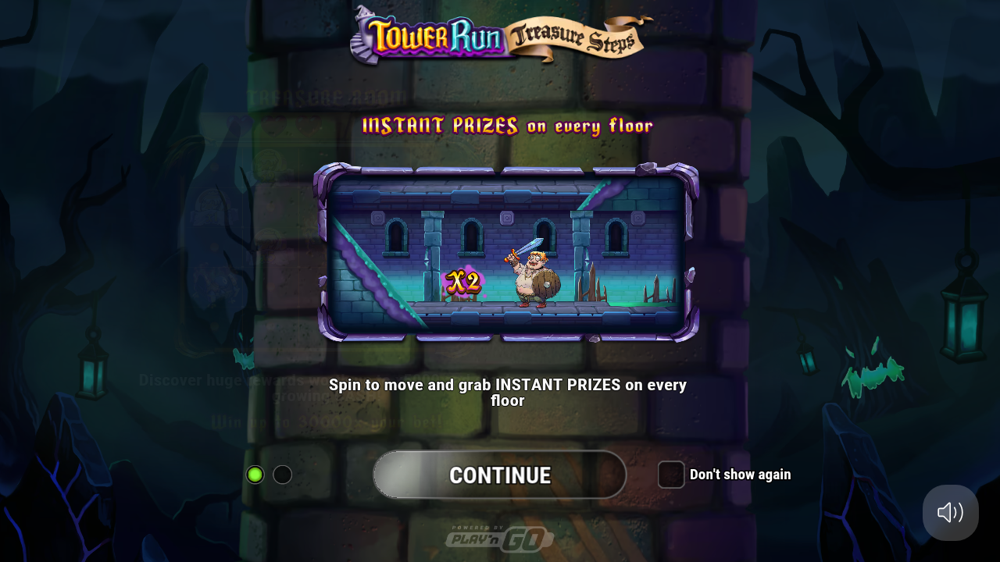
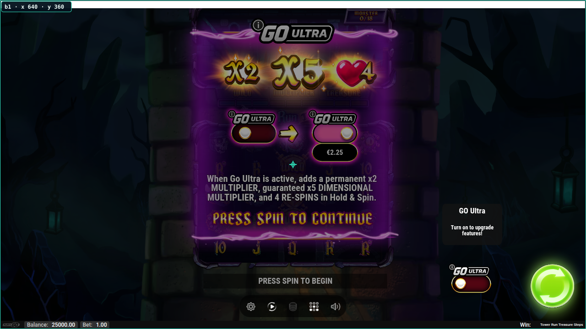
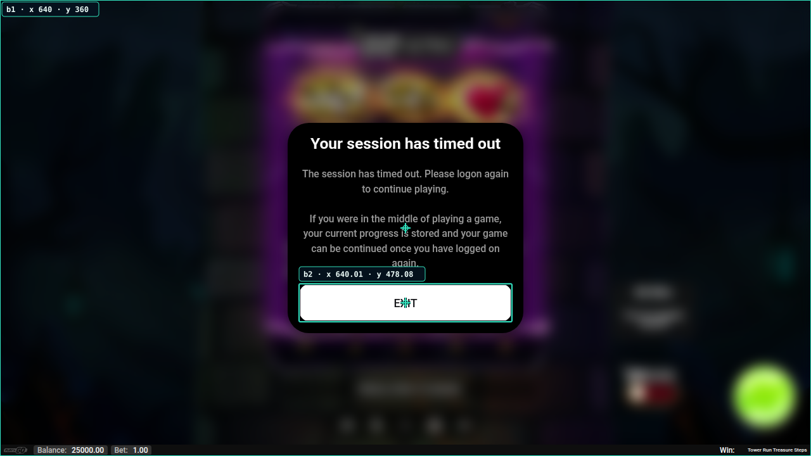
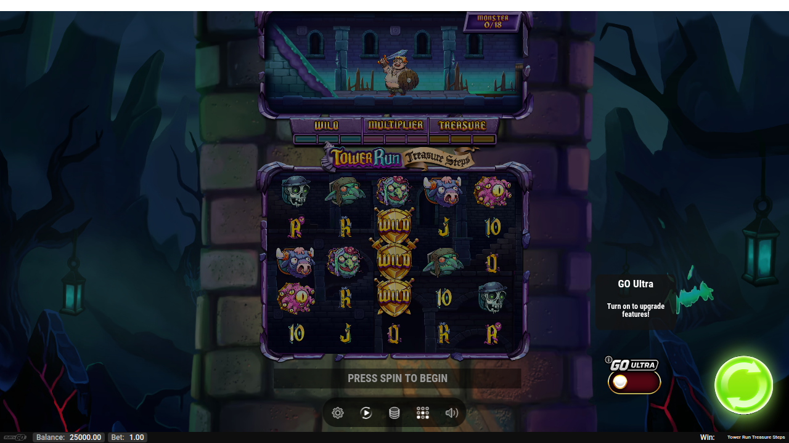
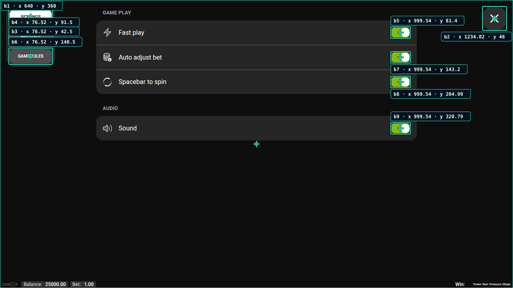
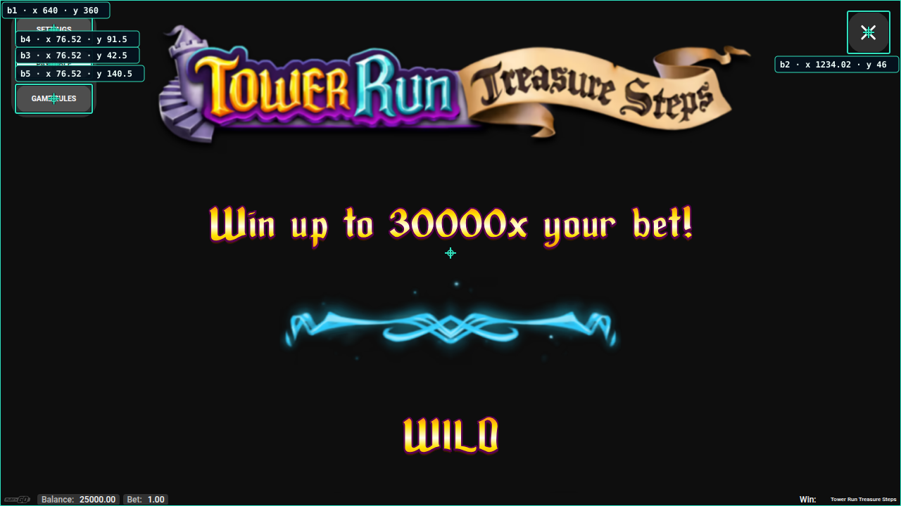
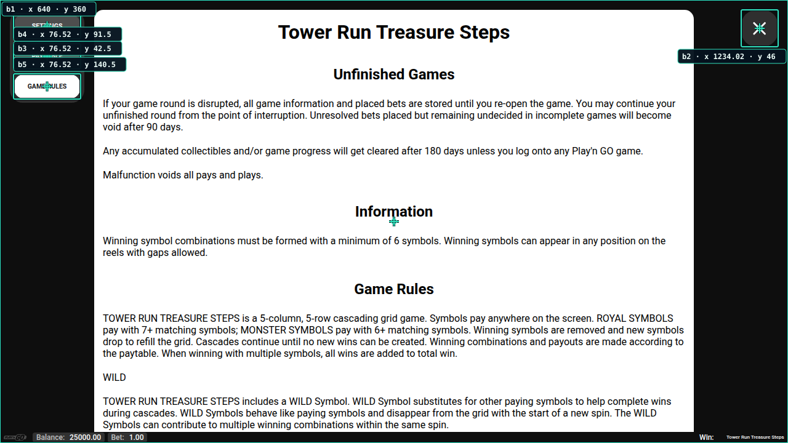

# Tower Run Treasure Steps: prueba por pantalla

Demo oficial ejecutada en [GitHub Actions, run 40235757252](https://github.com/Shisetsu-Code/firetrace/actions/runs/40235757252), el 25 de octubre de 2026. Sesión: `tower-run-screens-20261025-01`.

**Resultado:** ajustes ofrece ocho controles visibles localizados; tabla de pagos y reglas, cuatro en cada pantalla. Introducciones y tablero no proporcionaron posiciones útiles verificadas. Persisten etiquetas genéricas repetidas y un falso positivo que abarca toda la pantalla.

[Datos completos y coordenadas revisadas](tower-run-screen-walkthrough.json). El JSON conserva la salida original en `observation` y la selección tras inspección visual en `review.reviewedButtons`; esa selección no debe confundirse con un filtrado automático ya corregido.

Las coordenadas son **píxeles CSS del viewport de 1280 × 720**, con origen arriba a la izquierda. Cada `bN` pertenece a su observación. Cada `verify` explícito toma **tres muestras con pausas de 2000 ms**; la inspección y las capturas añaden tiempo, por lo que las muestras no están separadas exactamente dos segundos. No se solicitó visión IA.

| Verificación | Candidatos por muestra | Coordenadas publicadas | Estado | Duración total |
|---|---:|---:|---|---:|
| Introducción | 6 | 0 | Inestable | 20,17 s |
| Bienvenida GO ULTRA, sin filtro | 6 | 0 | Inestable | 39,09 s |
| Bienvenida GO ULTRA, filtrada | 1; se excluyeron 5 | 1 contenedor falso | Estable | 40,58 s |
| Sesión caducada | 2 | 2; sólo EXIT corresponde a un botón | Estable | 27,27 s |
| Tablero, nueva sesión | 7 | 0 | Inestable | 30,13 s |
| Ajustes | 9 | 8 controles y 1 contenedor falso | Estable | 34,77 s |
| Tabla de pagos → caducidad | 5 → 5 → 2 | 0 | Inestable | 23,95 s |
| Caducidad sobre tabla, filtrada | 1; se excluyó 1 | EXIT | Estable | 20,41 s |
| Tabla de pagos, nueva sesión | 5 | 4 controles y 1 contenedor falso | Estable | 25,15 s |
| Reglas del juego | 5 | 4 controles y 1 contenedor falso | Estable | 26,71 s |

## 1. Introducción

Las tres lecturas encontraron seis candidatos. Cambiaron la apariencia del contenedor DOM `49`, `continueBtn` y los indicadores. La diferencia máxima de apariencia fue **0,22719**, superior al umbral **0,015**. Resultado: **`buttons: []`**, sin posiciones publicadas.

[JSON de introducción](../ci-results/tower-run-screens-20261025-01/observations/2b4d9cfa-49b7-45cf-ae82-3f8158b87300/buttons.json).

## 2. Segunda bienvenida: GO ULTRA

La pantalla pide **“PRESS SPIN TO CONTINUE”**. La verificación sin filtros rechazó los seis candidatos por cambios de apariencia asociados a `button 7`. Al excluir exactamente esa etiqueta, desaparecieron **cinco candidatos en cada muestra**. Sólo quedó un contenedor DOM de **1280 × 720**, etiquetado con el saldo y el nombre del juego. Su estabilidad no demuestra que los botones estén correctamente aislados.

[JSON sin filtro](../ci-results/tower-run-screens-20261025-01/observations/a668eff9-e5eb-44cd-9a56-4bf46b31c5a7/buttons.json) · [JSON filtrado](../ci-results/tower-run-screens-20261025-01/observations/ab5ec159-3d10-4b92-ba26-1adb68c24a39/buttons.json).

### Colisión de etiquetas confirmada en código

El fallback de [dom-probe.cjs](../src/dom-probe.cjs) usa `${kind} ${serial}`, donde `serial` es el contador global actual. Tras registrar los elementos, [detector.cjs](../src/detector.cjs) vuelve a describir cada candidato: varios botones sin etiqueta reciben el mismo texto final, aunque sus identidades `dN` sean distintas. El filtro de [browser.cjs](../src/browser.cjs) excluye todas las coincidencias exactas. Por eso `button 7` eliminó cinco elementos y no únicamente el que variaba. No se corrigió el código durante esta prueba.

## 3. Sesión caducada

Un clic explícito en **(1206, 628)** dejó visible el aviso de sesión caducada. El saldo mostrado siguió en **25000.00**, con apuesta **1.00**. Esta evidencia no permite atribuirle una tirada ni afirmar que consumió una apuesta.

La verificación posterior fue estable: **EXIT** está correctamente localizado y el segundo candidato vuelve a ser el contenedor completo.

| Observación | ID | Candidato | Punto X | Punto Y | Recuadro: X, Y, ancho, alto | Evaluación |
|---|---|---|---:|---:|---|---|
| GO ULTRA filtrada | b1 | Contenedor DOM | 640,00 | 360,00 | 0; 0; 1280; 720 | Falso positivo como botón |
| Sesión caducada | b1 | Contenedor DOM | 640,00 | 360,00 | 0; 0; 1280; 720 | Falso positivo como botón |
| Sesión caducada | b2 | EXIT | 640,01 | 478,08 | 472; 448,11; 336,02; 59,94 | Botón confirmado visualmente |

[JSON de sesión caducada](../ci-results/tower-run-screens-20261025-01/observations/c3128443-0ea5-4c95-bd97-e5675f00f781/buttons.json).

## 4. Tablero de la nueva sesión

En esta sesión, el clic explícito en **(1206, 628)** cerró la bienvenida. La [captura inmediatamente posterior](../ci-results/tower-run-screens-20261025-01/observations/16a919d6-daf5-41f6-84bc-e0e003e2ad3f/screenshot.png) muestra **“PRESS SPIN TO BEGIN”** y conserva el saldo **25000.00**. No se observó una tirada en ese paso.

La verificación del tablero encontró **siete candidatos** en cada muestra, pero cambió la apariencia de `button 7`: diferencia máxima **0,12904**. Resultado: **inestable, cero coordenadas publicadas**.

[JSON del tablero](../ci-results/tower-run-screens-20261025-01/observations/25c8f8f9-e97e-4595-a579-a0684b3580dd/buttons.json).

## 5. Ajustes: ocho controles visibles y un contenedor falso

Las tres lecturas fueron idénticas: **nueve candidatos estables**, con **ocho controles reconocibles** y el contenedor de pantalla completa. La [captura sin anotaciones](../ci-results/tower-run-screens-20261025-01/observations/957180af-35cc-4e6b-a43f-878be59b67fc/screenshot.png) permite leer las pestañas que tapa parcialmente el overlay.

Los nombres funcionales de los cinco candidatos etiquetados `button 15` se identificaron visualmente; el detector devolvió esa etiqueta genérica repetida. El clic verificado en **b4/PAYTABLE** abrió la tabla de pagos.

| ID | Etiqueta del detector | Correspondencia visible | Punto X | Punto Y |
|---|---|---|---:|---:|
| b1 | Texto del contenedor DOM | Pantalla completa: falso positivo | 640,00 | 360,00 |
| b2 | button 15 | X, cerrar | 1234,02 | 46,00 |
| b3 | SETTINGS | Pestaña SETTINGS | 76,52 | 42,50 |
| b4 | PAYTABLE | Pestaña PAYTABLE | 76,52 | 91,50 |
| b5 | button 15 | Fast play | 999,54 | 81,40 |
| b6 | GAME RULES | Pestaña GAME RULES | 76,52 | 140,50 |
| b7 | button 15 | Auto adjust bet | 999,54 | 143,20 |
| b8 | button 15 | Spacebar to spin | 999,54 | 204,99 |
| b9 | button 15 | Sound | 999,54 | 320,79 |

[JSON de ajustes y recuadros](../ci-results/tower-run-screens-20261025-01/observations/957180af-35cc-4e6b-a43f-878be59b67fc/buttons.json).

## 6. Tabla de pagos

La primera apertura mediante [b4/PAYTABLE verificado](../ci-results/tower-run-screens-20261025-01/responses/000021.json) funcionó. Durante la comprobación posterior apareció el aviso de sesión caducada: cambió el conjunto de controles y no se publicaron posiciones. La siguiente verificación, con exclusión explícita del contenedor, publicó sólo EXIT. No se cuentan esos resultados como una tabla de pagos verificada.

Se renovó la demo y se reprodujo por coordenadas la ruta ya observada: Continue → cierre de bienvenida GO ULTRA → engranaje → PAYTABLE. Esas entradas fueron órdenes explícitas por coordenada, no clics a identificadores verificados.

En la nueva sesión, las tres lecturas fueron estables: **cuatro controles visibles y un contenedor falso positivo**, en **25,15 s**. Las imágenes de la tabla ya estaban cargadas en la captura final.

| ID | Etiqueta del detector | Correspondencia visible | Punto X | Punto Y |
|---|---|---|---:|---:|
| b1 | Texto de la página | Contenedor completo: falso positivo | 640,00 | 360,00 |
| b2 | button 5 | X, cerrar | 1234,02 | 46,00 |
| b3 | SETTINGS | SETTINGS | 76,52 | 42,50 |
| b4 | PAYTABLE | PAYTABLE | 76,52 | 91,50 |
| b5 | GAME RULES | GAME RULES | 76,52 | 140,50 |

[JSON de tabla de pagos](../ci-results/tower-run-screens-20261025-01/observations/782eabee-3a3d-4ace-9958-f45d74f8d6a1/buttons.json). El [clic verificado en b5/GAME RULES](../ci-results/tower-run-screens-20261025-01/responses/000035.json) se ejecutó correctamente en **(76,52; 140,50)**.

## 7. Reglas del juego

Las tres lecturas fueron estables en **26,71 s**. Volvió a publicar el contenedor completo y los cuatro controles de navegación: **X (1234,02; 46,00)**, **SETTINGS (76,52; 42,50)**, **PAYTABLE (76,52; 91,50)** y **GAME RULES (76,52; 140,50)**. En esta observación corresponden a b2, b3, b4 y b5. X sigue etiquetado automáticamente como `button 5`.

[JSON de reglas](../ci-results/tower-run-screens-20261025-01/observations/71c53b15-1034-42de-bafb-642576bf43ef/buttons.json).

## Cierre y límites

Se recorrieron introducción, bienvenida GO ULTRA, tablero, ajustes, tabla de pagos, reglas y avisos de caducidad. Dos aperturas de menús se ejecutaron por identificador verificado: PAYTABLE y GAME RULES. Los interruptores no se accionaron para comprobar sus efectos.

El [STOP explícito](../ci-results/tower-run-screens-20261025-01/responses/000037.json) cerró la sesión. GitHub Actions terminó con `success` y subió la evidencia. Ese estado confirma que el recorrido terminó; las limitaciones de detección descritas permanecen.

La siguiente mejora técnica necesaria es eliminar los contenedores que no son botones y dar etiquetas únicas a los controles anónimos antes de intentar filtrar sólo el elemento que cambia de apariencia. Esta prueba no cambió el código del detector ni relajó sus umbrales de estabilidad.
